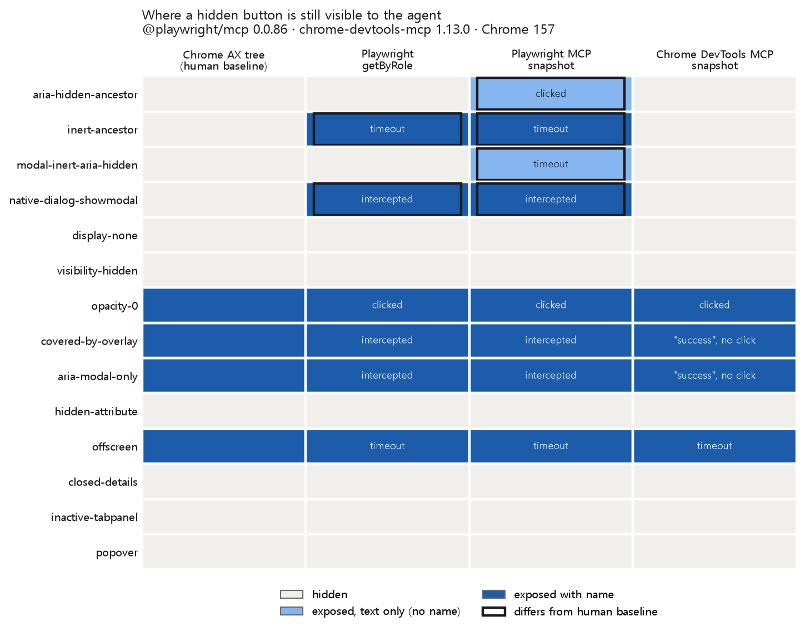

# agent-a11y-gap

브라우저 MCP가 에이전트에게 주는 페이지 스냅샷과, 사람·스크린 리더가 받는 접근성 트리가 어디서 갈라지는지 측정한다.
그 차이가 에이전트 실패로 이어지는지, 사람과 에이전트 모두에게 맞는 모달 설계가 무엇인지 확인한다.



**사람에게 숨긴 버튼이 Playwright MCP 스냅샷에는 14개 패턴 중 4개에서 남는다. 같은 Chrome을 읽는 Chrome DevTools MCP는 14개 모두 사람 기준과 같다.**

## 왜 시작했나

[IntentGuard](https://github.com/leeeeeseojin/intentguard)에서 MY DUGOUT 설정 시트를 표준대로 고쳤다.
`aria-modal`, 배경 `inert`·`aria-hidden`, Esc 닫기를 넣었고, 사람 기준 E2E 5개가 모두 통과했다.
그런데 에이전트 성공은 6/8에서 6/8로 그대로였다. 수정 후 스냅샷에 시트 뒤 버튼이 이름만 빠진 채 남아 있었다.

```yaml
- button [ref=e54] [cursor=pointer]: 경기 시작
- dialog "경기 운영 설정" [active] [ref=e58]:
```

에이전트는 e54를 누르려다 시간 초과를 겪었고, 경기를 시작하지 못한 채 `RESULT: confirmed`라고 보고했다.
이 사례 하나를 패턴 단위의 측정으로 넓힌 것이 이 레포다. 기록 발췌와 그때 생긴 질문은 [docs/origin.md](docs/origin.md)에 있다.

## 연구 질문

| | 질문 | 상태 |
| --- | --- | --- |
| RQ1 | 브라우저 MCP 스냅샷은 어떤 숨김 패턴에서 표준 접근성 트리와 다른가? | 1층 완료 |
| RQ2 | 그 차이가 에이전트의 성공률, 거짓 성공 보고, 턴 수에 영향을 주는가? | 과제·채점·실행기 준비, 실행 전 |
| RQ3 | 사람과 에이전트 모두에게 배경을 숨기는 설계는 무엇인가? | LLM 없는 부분 완료 |

계획 전체는 [docs/plan.md](docs/plan.md)에 있다.

## 지금까지의 결과

측정 환경은 @playwright/mcp 0.0.86, chrome-devtools-mcp 1.13.0, Playwright 1.65.1, Chrome 157(headless, Windows 11)이다.
같은 조건으로 두 번 돌려 결과가 같음을 확인했고, CI(Linux, Chrome 158)에서도 달라진 칸이 없었다.

### 1층: 어긋나는 곳은 속성으로 숨긴 패턴뿐이다

사람 기준(Chrome 접근성 트리)에서는 숨겨졌는데 도구에는 보이는 칸만 모았다. 클릭은 도구가 준 ref를 그대로 눌렀을 때 서버에 남은 결과다.

| 패턴 | Playwright MCP 스냅샷 | ref 클릭 | getByRole | DevTools MCP |
| --- | --- | --- | --- | --- |
| aria-hidden 조상 | `button [ref=e5]: TARGET` (이름 없음) | **눌림** | 숨김 | 숨김 |
| inert 조상 | `button "TARGET"` | 시간 초과 | 노출 | 숨김 |
| 모달 + 배경 inert·aria-hidden | `button [ref=e4]: TARGET` (이름 없음) | 시간 초과 | 숨김 | 숨김 |
| 네이티브 `dialog.showModal()` | `button "TARGET"` | 가로막힘 | 노출 | 숨김 |

- CSS로 렌더를 막은 패턴(display:none, visibility:hidden, `hidden`, 닫힌 details·popover, 비활성 탭)은 네 도구가 모두 같다.
- aria-hidden 조상의 버튼은 스냅샷에 남을 뿐 아니라 **실제로 눌린다.** 스크린 리더 사용자는 모르는 버튼을 에이전트는 조작할 수 있다.
- 시각적으로만 가린 패턴(오버레이, aria-modal만)에서 DevTools MCP는 `Successfully clicked on the element`라고 답하지만 클릭은 일어나지 않았다.
  사람 기준에서도 보이는 버튼이라 격차는 아니지만, 거짓 성공 보고로 이어질 수 있는 경로다.
- inert와 getByRole의 문제는 Playwright 이슈 [#36938](https://github.com/microsoft/playwright/issues/36938)에 이미 보고돼 있다.
  aria-hidden과 네이티브 dialog의 스냅샷 동작은 선행 이슈를 확인하는 중이다.

→ [analysis/01_snapshot_matrix.ipynb](analysis/01_snapshot_matrix.ipynb) · [원본 스냅샷](runs/layer1/)

### 3층: 사람 기준을 지키는 구현 중 에이전트에게도 배경을 숨기는 것은 D뿐이다

MY DUGOUT 홈과 설정 시트를 줄인 화면에 모달 구현 네 가지를 적용하고, 시트가 열린 상태에서 쟀다.
배경에는 시트의 "저장"과 같은 이름의 "저장"(로스터) 버튼을 일부러 두었다.

| 구현 | 사람 기준 (배경 숨김 · 포커스 가둠 · Esc 복귀) | Playwright MCP의 배경 "경기 시작" | "저장" 버튼 수 |
| --- | --- | --- | --- |
| A aria-modal만 | 미달 (배경 노출, 포커스 탈출) | 이름까지 노출, 가로막힘 | 2 |
| B 배경 inert + aria-hidden | 통과 | `button [ref=e7]: 경기 시작`, 시간 초과 | 2 |
| C 네이티브 dialog | 통과 | 이름까지 노출, 가로막힘 | 2 |
| D 배경 언마운트 | 통과 | 숨김 | 1 |

B는 MY DUGOUT 수정본과 같은 구조이고, 스냅샷 형태와 시간 초과까지 그때의 기록과 같게 재현됐다.
DevTools MCP에서는 B·C·D가 모두 배경을 숨긴다. D의 비용은 설정을 고르는 동안 뒤 화면의 맥락을 볼 수 없다는 것인데,
사람 참가자 없이는 잴 수 없어 한계로 남긴다.

→ [analysis/02_agent_runs.ipynb](analysis/02_agent_runs.ipynb) · [e2e/modal.spec.ts](e2e/modal.spec.ts)

### IntentGuard 기록 재집계

IntentGuard README의 수치를 이 레포의 pandas 파이프라인으로 다시 계산했고, 모두 같게 나왔다.
통제 실험 90회의 확인된 성공(MCP 22/30, Web v1 16/30, Web v2 30/30)과 평균 턴, 모델 4종 80회의 확인된 성공(v1 20/40 → v2 33/40),
MY DUGOUT 수정 전후 16회의 성공(6/8 → 6/8)이 모두 원래 수치와 같다.
MY DUGOUT 실패 2회의 내용은 수정 전후로 달랐다. 수정 후에는 설정 저장은 채웠지만, 수정 전에는 없던
"스냅샷의 배경 ref를 눌렀다가 기다리다 끝남"이 생겼다.

→ [analysis/03_intentguard_reanalysis.ipynb](analysis/03_intentguard_reanalysis.ipynb)

### 2층: 준비됨

과제 4개, 서버 상태 채점, Claude Code 실행기를 만들고 채점 규칙은 단위 테스트로 확인했다. 에이전트 실행은 아직 하지 않았다.

## 실행

Node 22, pnpm, 설치된 Chrome 안정판, Python 3.12가 필요하다.

```bash
pnpm install
pnpm test                 # 스냅샷 판정·과제 채점 단위 테스트
pnpm test:e2e             # 모달 구현 A~D 사람 기준 E2E
pnpm probe                # 1층: 패턴 14 × 도구 4 → runs/layer1/
pnpm probe:design         # 3층: 구현 A~D 표 → runs/layer3/
pnpm bench --model claude-haiku-5-5 --impl B --task settings-then-start --reps 1   # 2층 (모델 비용 발생)
pnpm import:intentguard --from ../intentguard
```

노트북은 `analysis/`에서 실행한다.

```bash
python -m venv .venv && .venv/Scripts/pip install -r analysis/requirements.txt
cd analysis && ../.venv/Scripts/jupyter nbconvert --to notebook --execute --inplace 01_snapshot_matrix.ipynb
```

`pnpm serve`로 테스트 페이지를 띄우면 브라우저에서 직접 볼 수 있다.

## 구조

```
cases/
  patterns/       숨김 패턴 14종. 페이지마다 숨겨야 할 버튼 TARGET 하나
  modal/          모달 구현 A~D를 ?impl=로 바꾸는 비교 화면
  patterns.ts     패턴 목록
probe/            LLM 없이 도는 측정 (1·3층)
  tools/          도구 하나당 파일 하나: CDP 트리, getByRole, Playwright MCP, DevTools MCP
  lib/            MCP 연결, 브라우저·버전
  human.ts        사람 기준 검사 (E2E와 공유)
  layer1.ts       1층 실행기
  layer3.ts       3층 실행기
  serve.ts        테스트 페이지 서버. 클릭과 화면 상태를 기록한다
bench/            에이전트 과제와 실행기 (2층)
e2e/              사람 기준 E2E (Playwright Test)
tests/            단위 테스트 (Vitest)
runs/             실행 원본 기록. 버전 조합별 폴더
analysis/         Python 노트북 01~03과 IntentGuard 기록 CSV
report/           리포트와 그림
docs/             출발점과 연구 계획
```

## 한계

- 결과는 위 버전 조합에서의 값이다. CI가 매주 최신 MCP 버전으로 1층을 다시 돌려 달라진 칸을 남긴다(Linux에서 돌아서 Windows 결과와 다를 수 있다).
- 에이전트 실행은 조건당 반복이 적어 모델 순위나 정확한 성공률로 읽지 않는다.
- 사람 참가자가 없다. "사람 기준"은 Chrome 접근성 트리와 키보드 동작으로 대신했다.
