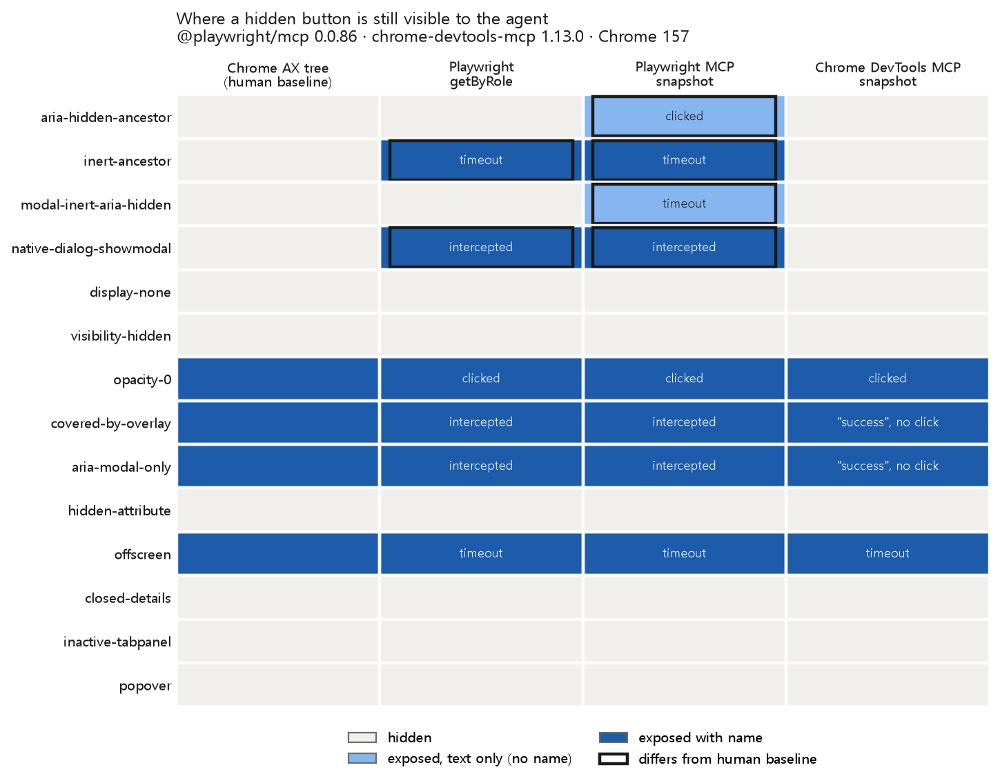

# 에이전트가 보는 화면과 사람이 보는 화면: 브라우저 MCP 접근성 격차

## 초록

사람과 스크린 리더에게 숨긴 버튼이 Playwright MCP 스냅샷에는 숨김 패턴 16종 중 6종에서 남으며, 에이전트가 `[aria-hidden]` 표시로 알아챌 수 있는 것은 그중 2종뿐이다. 같은 Chrome을 읽는 Chrome DevTools MCP는 16종 모두 사람 기준과 일치하였다. 모달 구현 네 가지 중 사람 기준과 두 MCP를 모두 만족한 것은 시트가 열린 동안 배경을 렌더하지 않는 구현(D) 하나였다. 표준 방식인 배경 `inert`·`aria-hidden`(B)은 사람 기준은 통과하지만 Playwright MCP 스냅샷에는 배경 버튼을 이름 없이 남긴다.

에이전트 실행에서 이 격차는 행동을 바꿨으나 성공률은 바꾸지 않았다. GPT-OSS 120B는 B에서 20회 중 5회 배경 버튼을 눌러 진행이 막혔고 D에서는 한 번도 막히지 않았지만, 확인된 성공은 B 16/20, D 15/20으로 같았다. Gemini 3.8 Flash와 Claude Sonnet 5.5는 B와 D 모두에서 실패가 없었다. 배경에 `[aria-hidden]` 표시를 남긴 구현(E)도 막힌 클릭을 줄이지 못하였으며(B 5/20, E 8/20), 모델은 표시를 보고도 그 버튼을 눌렀다. 관찰된 거짓 성공 중 여러 건은 숨김과 무관하게 한 화면에 같은 이름의 "저장" 버튼이 둘 있어서 발생하였고, 배경을 내린 D에서도 나타났다.

권고 사항을 MY DUGOUT 시트에 적용한 결과(B → D, 버튼 이름 구분, 시트 안 요약), 시트가 열린 동안 AI용 스냅샷에서 배경 버튼이 사라졌고 사람 기준 E2E도 그대로 통과하였다. 실제 앱에서는 상태 끌어올리기와 포커스 복귀 대상 재탐색이 추가로 필요하였다. 적용 후 에이전트 실행은 다시 하지 않았다.

## 1. 서론

[IntentGuard](https://github.com/leeeeeseojin/intentguard)에서 MY DUGOUT의 설정 시트를 다시 검사하였다. 시트가 열려 있는데도 GPT-OSS가 받은 스냅샷에는 시트 뒤의 "경기 시작" 버튼이 이름까지 포함되어 있었고, 에이전트는 그 버튼을 눌러 대기하다 종료된 뒤 `RESULT: confirmed`라고 보고하였다. 이는 사람 기준으로도 결함이므로 `aria-modal`, 배경 `inert`·`aria-hidden`, Esc 닫기를 추가하였고 사람 기준 E2E 5개가 모두 통과하였다. 그러나 4개 모델 × 2회의 성공은 수정 전후 모두 6/8이었다.

수정 후 스냅샷에서도 배경 버튼은 사라지지 않았다. 접근성 이름만 빠지고 텍스트와 ref는 남았다.

```yaml
- button [ref=e54] [cursor=pointer]: 경기 시작
- dialog "경기 운영 설정" [active] [ref=e58]:
```

IntentGuard의 v2 화면에서 성공률을 높인 개선은 대부분 보이는 정보를 더하는 것이었다. 이번 수정은 보이는 정보를 빼는 것이었고, 속성으로 뺀 정보는 스냅샷에서 빠지지 않을 수 있다. 본 연구는 이 가정을 세 층으로 나누어 확인하였다(경위는 [docs/origin.md](../docs/origin.md) 참고).

표 1. 연구 구성

| 층 | 질문 | 방법 |
| --- | --- | --- |
| 1층 | 스냅샷은 어떤 숨김 패턴에서 사람 기준과 다른가 (RQ1) | 패턴 16종 × 도구 4종, LLM 없음 |
| 2층 | 그 차이가 에이전트 결과를 바꾸는가 (RQ2) | 모달 과제 4개를 실제 에이전트에게 수행시키고 서버 상태로 채점 |
| 3층 | 양쪽에 맞는 모달 설계는 무엇인가 (RQ3) | 같은 화면에 구현 A-D를 적용하고 사람 기준과 MCP 결과를 함께 측정 |

측정 환경은 @playwright/mcp 0.0.86, chrome-devtools-mcp 1.13.0, Playwright 1.65.1, Chrome 157이다.

## 2. RQ1: 격차는 속성으로 숨긴 패턴에서만 생긴다



사람 기준은 Chrome 접근성 트리(CDP `Accessibility.getFullAXTree`)로 정하였다. 이 기준과 Playwright MCP 스냅샷이 다른 패턴은 aria-hidden 3종, inert 조상, 모달 + 배경 inert·aria-hidden, 네이티브 `dialog.showModal()`의 6종이다. `display:none`, `visibility:hidden`처럼 CSS로 렌더링을 막은 패턴에서는 네 도구가 모두 같았다(그림 1).

aria-hidden 버튼은 스냅샷에 남을 뿐 아니라 실제로 눌린다. 스크린 리더 사용자는 알 수 없는 버튼을 에이전트는 조작할 수 있다는 뜻이다. inert와 모달 밖 버튼도 스냅샷에 남지만, 누르면 대기하다 종료된다. 이는 Playwright 1.65가 정한 동작으로([#43792](https://github.com/microsoft/playwright/issues/43792)), 로케이터와 스냅샷은 이런 요소를 걸러내지 않고 클릭할 때 `element is inert`로 대기한다.

`[aria-hidden]` 표시가 빠지는 구조도 확인하였다. AI 모드 스냅샷은 aria-hidden 요소를 의도적으로 포함하고 표시를 붙인다([#42268](https://github.com/microsoft/playwright/pull/42268)). 그러나 속성이 자식 하나뿐인 이름 없는 div에 있으면, 스냅샷을 줄이는 단계(`unwrapSingleChildGenerics`)에서 div가 펼쳐지며 표시가 버려진다. React 앱은 `#root` 안에 래퍼 하나만 두므로, `#root`에 aria-hidden을 거는 일반적인 모달 처리가 정확히 이 경우에 해당한다. MY DUGOUT의 `button [ref=e54]: 경기 시작`에 표시가 없었던 이유도 이것이다.

DevTools MCP는 16종 모두 사람 기준과 같았다. 다만 오버레이로 가린 버튼에 대해 `Successfully clicked`라고 응답하고 실제로는 누르지 않았다. 사람에게도 보이는 버튼이므로 격차에 해당하지는 않지만, 거짓 성공 보고로 이어질 수 있는 경로이다.

## 3. RQ2: 격차는 행동을 바꾸지만 성공률은 바꾸지 않았다

모달을 거쳐야 하는 과제 4개(설정 바꾸고 시작, 같은 이름 저장, 닫고 시작, 읽기만)를 구현 B와 D에서 수행하게 하였다. 배경에는 시트의 "저장"과 같은 이름의 로스터 "저장" 버튼을 의도적으로 두었다. 채점은 에이전트의 보고가 아니라 화면이 서버에 기록한 상태로 하였다. 에이전트에게는 브라우저 MCP만 제공하고, 페이지 안에서 코드를 실행하는 도구는 막았다.

표 2. 본실험 결과(모델 3 × 과제 4 × B·D × 2회, 48회)

| 모델 (실행기) | B 확인된 성공 | D 확인된 성공 | B에서 생긴 문제 |
| --- | --- | --- | --- |
| Gemini 3.8 Flash (Antigravity CLI) | 8/8 | 8/8 | 없음 |
| GPT-OSS 120B (OpenAI 호환 API) | 7/8 | 8/8 | 막힌 클릭 1, 거짓 성공 1 |
| Claude Sonnet 5.5 (OpenAI 호환 API) | 8/8 | 8/8 | 없음 |

문제가 발생한 모델이 GPT-OSS뿐이었으므로, GPT-OSS에 한해 배경 버튼이 관련되는 두 과제의 B·D 실행을 10회씩으로 늘렸다. 같은 두 과제를 구현 E로도 10회씩 실행하였다. E는 B와 같지만 시트가 열린 동안 배경 영역(`#app`)에 `role="region"`과 이름을 붙여 스냅샷에 `[aria-hidden]` 표시가 남게 한 구현이다([docs/aria-hidden-mark.md](../docs/aria-hidden-mark.md)의 우회 2).


표 3. GPT-OSS 120B 추가 실행(두 과제 합계)

| GPT-OSS 120B, 두 과제 합계 | B | D | E | B 대 D Fisher p | B 대 E Fisher p |
| --- | --- | --- | --- | --- | --- |
| 확인된 성공 | 16/20 | 15/20 | 15/20 | 1.00 | 1.00 |
| 거짓 성공 | 3/20 | 1/20 | 3/20 | 0.61 | 1.00 |
| 배경 버튼에서 막힌 클릭이 있었던 실행 | 5/20 | 0/20 | 8/20 | 0.047 | 0.50 |

행동에는 차이가 나타났다. 배경 버튼을 눌러 막힌 실행은 B에서만 나왔다. 시트를 연 뒤 "저장"을 찾으면 배경의 `button [ref=e13]: 저장`이 시트의 저장 버튼보다 먼저, 아무 표시 없이 나오고, 모델은 그 버튼을 눌렀다. 1층에서 관찰한 동작이 실제 에이전트에게 그대로 일어난 것이다. 다섯 번 중 네 번은 다시 탐색해 시트의 저장 버튼을 눌렀다. 나머지 한 번은 막힌 뒤 이전 ref를 반복해 누르다 설정을 저장하지 않고 경기를 시작하였고, "저장한 뒤 시작했다"고 보고하였다. MY DUGOUT에서 관찰한 실패와 같은 형태이다.

성공률은 같았다. "설정 바꾸고 시작"에서는 오히려 D가 6/10으로 낮았다. D의 실패에는 배경 버튼을 누른 흔적이 없었고, 공격 작전을 저장하지 못했거나 60턴 한도까지 과제를 끝내지 못한 경우였다. GPT-OSS의 실패 상당수는 화면과 무관한 습관에서 비롯되었다. 본실험에서 GPT-OSS는 스냅샷 25번 중 15번을 파일로 저장해 내용을 받지 않았고, 존재하지 않는 도구를 호출하거나 사라진 ref를 다시 누르기도 하였다.

같은 이름의 버튼은 거짓 성공으로 이어졌다. "같은 이름 저장"의 거짓 성공 두 번은 모두 B에서 나왔고, 둘 다 시트를 닫은 뒤 배경의 로스터 "저장"을 눌렀다. 숨긴 요소가 노출되어 생긴 실패가 아니라, 한 화면에 같은 이름의 동작 버튼이 둘 있어서 생긴 실패이다.

`[aria-hidden]` 표시는 배경 클릭을 줄이지 못하였다. 표시가 남는 E에서 막힌 클릭이 있던 실행은 8/20으로 B보다 적지 않았다. 모델은 `browser_find` 결과에서 `region [aria-hidden]` 바로 아래의 `button [ref=e14]: 저장`을 보고도 그 버튼을 눌렀다. 표시는 사람에게 숨겨졌다는 사실을 알려 줄 뿐, 에이전트에게는 누르지 말라는 신호로 읽히지 않았다.

막힌 클릭에 대한 B 대 D의 p = 0.047은 같은 표본에 여러 검정을 수행한 값이므로 강한 근거로 쓰지 않는다. 다만 배경이 스냅샷에 남는 B·E를 합치면 40회 중 13회, 배경을 내린 D는 20회 중 0회이므로 방향은 분명하다.

보조 실험으로 Chrome DevTools MCP를 사용하였다(Claude Haiku 5.5, Claude Code 실행기, 과제 4 × B·D × 2회). 1층에서 DevTools MCP는 B의 배경도 숨겼으며, 에이전트 결과도 이와 같아 B와 D 모두 막힌 클릭이 없었다(B 8/8 성공). D에서 나온 거짓 성공 두 번은 모두 "같은 이름 저장" 과제에서, 시트에서 설정을 올바르게 저장한 뒤 닫혀 다시 그려진 홈의 로스터 "저장"까지 누른 경우였다. 배경을 내려도 같은 이름 버튼 문제는 남는다는 것을 다른 모델과 도구에서도 확인하였다.

## 4. RQ3: 양쪽 기준을 모두 만족하는 것은 배경을 내리는 구현뿐이다

MY DUGOUT 홈과 설정 시트를 축소한 화면에 구현 다섯 가지를 적용하고, 시트가 열린 상태에서 측정하였다. 사람 기준은 배경 숨김(접근성 트리), 포커스 가둠, Esc로 닫은 뒤 포커스 복귀의 세 가지이다.

표 4. 모달 구현별 결과

| 구현 | 사람 기준 | Playwright MCP의 배경 "경기 시작" | 스냅샷의 "저장" 버튼 수 |
| --- | --- | --- | --- |
| A aria-modal만 | 미달 (배경 노출, 포커스 탈출) | 이름까지 노출, 가로막힘 | 2 |
| B 배경 inert + aria-hidden | 통과 | 이름 없이 노출, 누르면 시간 초과 | 2 |
| C 네이티브 dialog | 통과 | 이름까지 노출, 가로막힘 | 2 |
| D 배경 언마운트 | 통과 | 숨김 | 1 |
| E = B + 열린 동안 배경 영역 이름 | 통과 | `region [aria-hidden]` 아래 노출, 누르면 시간 초과 | 2 |

B는 MY DUGOUT 수정본과 같은 구조이며, 스냅샷 형태와 시간 초과까지 당시 기록이 그대로 재현되었다. DevTools MCP에서는 B·C·D·E 모두 배경이 숨겨진다.

이로부터 세 가지 설계 권고를 도출하였다.

1. 에이전트도 사용하는 화면이라면 모달이 열린 동안 배경을 렌더하지 않는다(D). D는 사람 기준과 두 MCP를 모두 만족한 유일한 구현이며, 2층에서 배경 버튼에 막힌 실행이 한 번도 없었다.
2. `[aria-hidden]` 표시를 살리는 우회는 D를 대신하지 못한다. 시트가 열린 동안 `#root`에 `role="region"`과 이름을 붙이면 표시는 남지만(E), GPT-OSS는 표시를 보고도 배경 버튼을 눌렀다. 표시 누락 자체는 Playwright 쪽에서 수정할 문제로 남긴다.
3. 한 화면에 같은 이름의 동작 버튼을 두지 않는다. B·E의 거짓 성공 여섯 번 중 세 번과 DevTools MCP 보조 실험의 D 두 번이 숨김과 무관하게 같은 이름의 "저장"에서 발생하였다. D에서도 시트를 닫으면 배경이 다시 그려지므로 이 문제는 구현과 별개로 남는다.

D의 비용은 설정을 고르는 동안 뒤 화면의 상태를 볼 수 없다는 점이다. 이는 사람 참가자 없이는 측정할 수 없어 후속 과제로 남긴다.

### 4.1 적용: MY DUGOUT

출발점이 된 MY DUGOUT의 설정·선수 카드·선수 편집 시트에 세 권고를 적용하였다(커밋 5개, [0e3bf5f...f1c4912](https://github.com/leeeeeseojin/my-dugout/compare/0e3bf5f...f1c4912)).

표 5. MY DUGOUT 적용 내용

| 권고 | 적용 |
| --- | --- |
| 1. 배경을 렌더하지 않는다 | `#root`의 `inert`·`aria-hidden`을 없애고, 시트를 쓰는 화면 네 곳이 열린 동안 시트와 버튼 없는 배경 그림만 그린다 |
| 3. 같은 이름의 동작 버튼을 두지 않는다 | 시트의 "저장"·"삭제"·"닫기"를 "선수 저장"·"선수 삭제"·"설정 닫기" 등으로, 로스터 목록의 "파일로 저장"을 "로스터 파일로 저장"으로 |
| D의 비용 보완 | 시트 위쪽에 한 줄 요약. 경기 중에는 이닝·점수·아웃·주자, 라인업 선수 카드에는 그 선수의 타순, 선수 편집에는 로스터 현황 |

MY DUGOUT의 E2E로 확인하였다. 시트가 열린 동안 AI용 스냅샷(`ariaSnapshot({ mode: 'ai' })`)에는 배경 버튼도, 이름 없는 버튼 줄도 없으며, 스냅샷의 버튼 수가 시트 안 버튼 수와 같다. 같은 테스트를 수정 전(B) 빌드에 실행하면 실패한다. 기존 사람 기준 E2E 5개는 그대로 통과하였고, 포커스 가둠·포커스 복귀·버튼 이름 중복·시트 안 요약 테스트를 추가해 13개가 통과한다.

3층의 축소 화면에서는 드러나지 않았지만, 실제 앱에서 D를 쓰려면 추가 작업이 필요하였다. 첫째, 언마운트되는 쪽의 상태를 상위로 올려야 했다. 경기 중 작전 패널에서 골라 둔 작전이 시트를 여닫으면 사라졌으므로, 그 값을 경기 화면으로 올렸다. 둘째, 포커스 복귀 대상을 다시 찾아야 했다. 시트를 닫으면 배경이 새로 그려지므로 시트를 연 버튼도 새 요소가 된다. 여는 버튼에 `data-opener` 이름표를 달고 닫을 때 그 이름표로 찾도록 하였다. B에서 `inert`가 담당하던 포커스 가둠도 Tab 처리로 직접 구현하였다. 셋째, 배경의 시간 흐름이 끊긴다. 코치에게 맡긴 판단의 대기 시간은 시트가 열린 동안 멈추고, 닫으면 처음부터 다시 센다. B에서는 시트를 보는 동안에도 배경에서 대기 시간이 흘러 결정이 내려질 수 있었으므로, 이는 사람에게도 개선된 변화이다.

시트 안 요약은 D의 비용을 줄이기 위한 설계이며, 사람에게 충분한지는 측정하지 않았다.

## 5. 한계

결과는 기재된 버전 조합에서의 값이다. CI가 매주 최신 MCP로 1층을 다시 실행해 달라진 항목을 기록한다.

표본이 작다. 2층은 모델별로 구현당 8회, GPT-OSS 추가 실행은 구현당 20회, DevTools MCP 보조 실험은 구현당 8회이므로, 성공률이나 모델 순위로 해석하지 않는다.

실행기가 모델마다 다르다. Antigravity의 주간 사용량 한도가 Claude·GPT 모델 그룹에서 먼저 소진되어, Gemini는 Antigravity CLI로, GPT-OSS와 Sonnet은 직접 만든 OpenAI 호환 API 실행기(OpenRouter)로 실행하였다. 시스템 지시와 사용 가능한 도구가 다르므로 모델 간 비교는 하지 않고 같은 모델 안에서 B와 D만 비교하였다. GPT-OSS의 실행 조건은 MY DUGOUT에서 실패한 Antigravity 조건과도 다르다.

사람 참가자가 없다. 사람 기준은 Chrome 접근성 트리와 키보드 동작으로 대신하였으며, D가 사람에게 주는 비용은 측정하지 않았다.

자체 테스트 페이지에서만 실행하였으므로, 실제 서비스 화면에서 같은 비율로 일어난다고 말할 수 없다. MY DUGOUT 적용은 스냅샷과 E2E로만 확인하였고, 에이전트 실행으로 막힌 클릭이 사라졌는지는 측정하지 않았다.

## 6. 선행 이슈

inert와 모달 dialog 밖 콘텐츠가 스냅샷에 남는 문제는 [#36938](https://github.com/microsoft/playwright/issues/36938)이 PR [#43211](https://github.com/microsoft/playwright/pull/43211)로 닫혔고, 1.65 API 리뷰 [#43792](https://github.com/microsoft/playwright/issues/43792)에서 이런 요소를 걸러내지 않고 동작 시 대기하는 방향으로 정리되었다. 새로운 발견이 아니라 정해진 설계이며, 본 보고서는 그 설계가 에이전트에게 만드는 행동을 측정하였다.

aria-hidden 요소를 AI 스냅샷에 포함하고 표시를 붙이는 동작은 PR [#42268](https://github.com/microsoft/playwright/pull/42268)에서 도입되었다.

그 표시가 자식 하나뿐인 div를 펼칠 때 사라지는 문제는 playwright와 playwright-mcp에서 다룬 이슈를 찾지 못하였다. 원인 코드, Playwright 쪽 수정 방법 두 가지, 화면 쪽 우회 두 가지를 [docs/aria-hidden-mark.md](../docs/aria-hidden-mark.md)에 정리하였다.

## 재현

```bash
pnpm probe          # 1층
pnpm probe:design   # 3층
pnpm bench --agent api --model openai/gpt-oss-120b --impl B --impl D --reps 2   # 2층 (OpenRouter 키는 .env)
```

수치와 그림은 [analysis/01_snapshot_matrix.ipynb](../analysis/01_snapshot_matrix.ipynb), [02_agent_runs.ipynb](../analysis/02_agent_runs.ipynb), [03_intentguard_reanalysis.ipynb](../analysis/03_intentguard_reanalysis.ipynb)에서 생성된다. 실행 기록은 [runs/](../runs/)에 있다.
