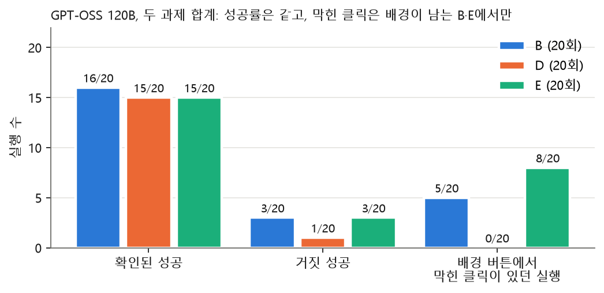

# 에이전트가 보는 화면과 사람이 보는 화면: 브라우저 MCP 접근성 격차

## 요약

- 사람과 스크린 리더에게 숨긴 버튼이 Playwright MCP 스냅샷에는 숨김 패턴 16종 중 6종에서 남는다.
  에이전트가 `[aria-hidden]` 표시로 알아챌 수 있는 것은 그중 2종뿐이다. 같은 Chrome을 읽는 Chrome DevTools MCP는 16종 모두 사람 기준과 같다.
- 모달 구현 네 가지 중 사람 기준과 두 MCP를 모두 만족하는 것은 시트가 열린 동안 배경을 내리는 구현(D) 하나다.
  표준 방식인 배경 `inert`·`aria-hidden`(B)은 사람 기준은 통과하지만 Playwright MCP에는 배경 버튼을 이름 없이 남긴다.
- 에이전트 실행에서 이 격차는 **행동을 바꿨지만 성공률은 바꾸지 않았다.** GPT-OSS 120B는 B에서 20회 중 5회 배경 버튼을 눌러
  막혔고 D에서는 한 번도 막히지 않았다. 그러나 확인된 성공은 B 16/20, D 15/20으로 같았다. Gemini 3.8 Flash와
  Claude Sonnet 5.5는 B와 D 모두 실패가 없었다.
- 배경에 `[aria-hidden]` 표시를 살린 구현(E)도 막힌 클릭을 줄이지 못했다(B 5/20, E 8/20). 모델은 표시를 보고도 그 버튼을 눌렀다.
  관찰한 거짓 성공 중 여럿은 숨김과 상관없이 한 화면에 같은 이름의 "저장"이 둘 있어서 생겼고, 배경을 내린 D에서도 나왔다.

## 1. 문제: 표준대로 고쳤는데 에이전트 결과가 같았다

[IntentGuard](https://github.com/leeeeeseojin/intentguard)에서 MY DUGOUT의 설정 시트를 다시 검사했다. 시트가 열려 있는데도
GPT-OSS가 받은 스냅샷에는 시트 뒤 "경기 시작" 버튼이 이름까지 붙어 있었고, 에이전트는 그 버튼을 눌렀다가 기다리다 끝난 뒤
`RESULT: confirmed`라고 보고했다. 사람 기준으로도 결함이라 `aria-modal`, 배경 `inert`·`aria-hidden`, Esc 닫기를 넣었고
사람 기준 E2E 5개가 모두 통과했다. 그런데 4개 모델 × 2회의 성공은 6/8에서 6/8로 그대로였다.

수정 후 스냅샷에서도 배경 버튼은 사라지지 않았다. 접근성 이름만 빠지고 텍스트와 ref가 남았다.

```yaml
- button [ref=e54] [cursor=pointer]: 경기 시작
- dialog "경기 운영 설정" [active] [ref=e58]:
```

IntentGuard의 v2 화면이 성공률을 올린 개선은 대부분 보이는 정보를 **더하는** 것이었다. 이번 수정은 보이는 것을 **빼는** 것이었고,
속성으로 뺀 것은 스냅샷에서 빠지지 않을 수 있다. 이 가정을 세 층으로 나눠 확인했다(자세한 경위는 [docs/origin.md](../docs/origin.md)).

| 층 | 질문 | 방법 |
| --- | --- | --- |
| 1층 | 스냅샷은 어떤 숨김 패턴에서 사람 기준과 다른가 (RQ1) | 패턴 16종 × 도구 4종, LLM 없음 |
| 2층 | 그 차이가 에이전트 결과를 바꾸는가 (RQ2) | 모달 과제 4개를 실제 에이전트에게 시키고 서버 상태로 채점 |
| 3층 | 양쪽에 맞는 모달 설계는 무엇인가 (RQ3) | 같은 화면에 구현 A~D를 적용하고 사람 기준과 MCP 결과를 함께 잼 |

측정 환경은 @playwright/mcp 0.0.86, chrome-devtools-mcp 1.13.0, Playwright 1.65.1, Chrome 157이다.

## 2. RQ1: 격차는 속성으로 숨긴 패턴에서만 생긴다


사람 기준은 Chrome 접근성 트리(CDP `Accessibility.getFullAXTree`)다. 이 기준과 Playwright MCP 스냅샷이 다른 칸은
aria-hidden 3종, inert 조상, 모달 + 배경 inert·aria-hidden, 네이티브 `dialog.showModal()`의 6종이다.
`display:none`, `visibility:hidden`처럼 CSS로 렌더를 막은 패턴은 네 도구가 모두 같았다.

- **aria-hidden 버튼은 남을 뿐 아니라 실제로 눌린다.** 스크린 리더 사용자는 모르는 버튼을 에이전트는 조작할 수 있다.
- **inert와 모달 밖 버튼은 남지만 누르면 기다리다 끝난다.** Playwright 1.65가 정한 동작이다
  ([#43792](https://github.com/microsoft/playwright/issues/43792)). 로케이터와 스냅샷은 이런 요소를 걸러내지 않고,
  클릭할 때 `element is inert`로 기다린다.
- **`[aria-hidden]` 표시가 빠지는 구조가 있다.** AI 모드 스냅샷은 aria-hidden 요소를 일부러 포함하고 표시를 붙인다
  ([#42268](https://github.com/microsoft/playwright/pull/42268)). 그런데 속성이 자식 하나뿐인 이름 없는 div에 있으면,
  스냅샷을 줄이는 단계(`unwrapSingleChildGenerics`)에서 div가 펼쳐지며 표시가 버려진다. React 앱은 `#root` 안에 래퍼 하나만 두므로
  `#root`에 aria-hidden을 거는 흔한 모달 처리가 정확히 이 경우다. MY DUGOUT의 `button [ref=e54]: 경기 시작`에 표시가 없던 이유다.
- **DevTools MCP는 16종 모두 사람 기준과 같았다.** 다만 오버레이로 가린 버튼에 `Successfully clicked`라고 답하고
  실제로는 누르지 않았다. 사람에게도 보이는 버튼이라 격차는 아니지만 거짓 성공 보고로 이어질 수 있는 경로다.

## 3. RQ2: 격차는 행동을 바꾸지만 성공률은 바꾸지 않았다

모달을 거쳐야 하는 과제 4개(설정 바꾸고 시작, 같은 이름 저장, 닫고 시작, 읽기만)를 구현 B와 D에서 돌렸다.
배경에는 시트의 "저장"과 같은 이름의 로스터 "저장"을 일부러 두었다. 채점은 에이전트의 보고가 아니라 화면이 서버에 올린 상태로 했다.
에이전트에게는 브라우저 MCP만 주고, 페이지 안에서 코드를 실행하는 도구는 막았다.

**본실험** (모델 3 × 과제 4 × B·D × 2회, 48회)

| 모델 (실행기) | B 확인된 성공 | D 확인된 성공 | B에서 생긴 문제 |
| --- | --- | --- | --- |
| Gemini 3.8 Flash (Antigravity CLI) | 8/8 | 8/8 | 없음 |
| GPT-OSS 120B (OpenAI 호환 API) | 7/8 | 8/8 | 막힌 클릭 1, 거짓 성공 1 |
| Claude Sonnet 5.5 (OpenAI 호환 API) | 8/8 | 8/8 | 없음 |

문제가 난 모델이 GPT-OSS뿐이라, GPT-OSS만 배경 버튼이 걸리는 두 과제의 B·D를 10회씩으로 늘렸다.
같은 두 과제를 구현 E로도 10회씩 돌렸다. E는 B와 같지만 시트가 열린 동안 배경 영역(`#app`)에 `role="region"`과 이름을 붙여
스냅샷에 `[aria-hidden]` 표시가 남게 한 것이다([docs/aria-hidden-mark.md](../docs/aria-hidden-mark.md)의 우회 2).



| GPT-OSS 120B, 두 과제 합계 | B | D | E | B 대 D Fisher p | B 대 E Fisher p |
| --- | --- | --- | --- | --- | --- |
| 확인된 성공 | 16/20 | 15/20 | 15/20 | 1.00 | 1.00 |
| 거짓 성공 | 3/20 | 1/20 | 3/20 | 0.61 | 1.00 |
| 배경 버튼에서 막힌 클릭이 있었던 실행 | 5/20 | 0/20 | 8/20 | 0.047 | 0.50 |

- **행동에는 흔적이 남았다.** 배경 버튼을 눌러 막힌 실행은 B에서만 나왔다. 시트를 연 뒤 "저장"을 찾으면 배경의
  `button [ref=e13]: 저장`이 시트의 저장보다 먼저, 아무 표시 없이 나오고, 모델은 그것을 눌렀다. 1층의 동작이 그대로 일어났다.
- **대부분은 회복했다.** 다섯 번 중 네 번은 다시 찾아 시트의 저장을 눌렀다. 한 번은 막힌 뒤 예전 ref를 거듭 누르다
  설정을 저장하지 않고 경기를 시작했고, "저장한 뒤 시작했다"고 보고했다. MY DUGOUT에서 본 실패와 같은 모양이다.
- **성공률은 같았다.** "설정 바꾸고 시작"에서는 오히려 D가 6/10으로 낮았다. D의 실패에는 배경 버튼을 누른 흔적이 없고,
  공격 작전을 저장하지 못하거나 60턴 한도까지 헤맨 경우였다. GPT-OSS의 실패 상당수는 화면과 상관없는 습관에서 왔다.
  본실험에서는 스냅샷 25번 중 15번을 파일로 저장해 내용을 받지 않았고, 없는 도구를 부르거나 사라진 ref를 다시 누르기도 했다.
- **같은 이름 버튼이 거짓 성공을 만들었다.** "같은 이름 저장"의 거짓 성공 두 번은 모두 B였고, 둘 다 시트를 닫은 뒤
  배경의 로스터 "저장"을 눌렀다. 숨긴 요소가 노출되어 생긴 실패가 아니라, 한 화면에 같은 이름의 동작 버튼이 둘 있어서 생긴 실패다.
- **`[aria-hidden]` 표시는 배경 클릭을 줄이지 못했다.** 표시가 남는 E에서 막힌 클릭이 있던 실행은 8/20으로 B보다 적지 않았다.
  모델은 `browser_find` 결과에서 `region [aria-hidden]` 바로 아래의 `button [ref=e14]: 저장`을 보고도 그 버튼을 눌렀다.
  표시는 사람에게 숨겨졌다는 사실을 알려 줄 뿐, 에이전트에게 누르지 말라는 신호로 읽히지 않았다.

막힌 클릭의 B 대 D p = 0.047은 같은 표본에 여러 검정을 한 값이라 강한 근거로 쓰지 않는다. 다만 배경이 스냅샷에 남는 B·E를 합치면
40회 중 13회, 배경을 내린 D는 20회 중 0회라서 방향은 분명하다.

**보조 실험: Chrome DevTools MCP** (Claude Haiku 5.5, Claude Code 실행기, 과제 4 × B·D × 2회)

1층에서 DevTools MCP는 B의 배경도 숨겼다. 에이전트 결과도 같아서 B와 D 모두 막힌 클릭이 없었다(B 8/8 성공).
D에서 나온 거짓 성공 두 번은 모두 "같은 이름 저장"에서, 시트에서 설정을 제대로 저장한 뒤 닫혀 다시 그려진 홈의 로스터 "저장"까지 누른 경우였다.
배경을 내려도 같은 이름 버튼 문제는 남는다는 것을 다른 모델과 도구에서도 확인했다.

## 4. RQ3: 양쪽 기준을 모두 만족하는 것은 배경을 내리는 구현뿐이다

MY DUGOUT 홈과 설정 시트를 줄인 화면에 구현 다섯 가지를 적용하고 시트가 열린 상태에서 쟀다.
사람 기준은 배경 숨김(접근성 트리), 포커스 가둠, Esc로 닫고 포커스 복귀의 세 가지다.

| 구현 | 사람 기준 | Playwright MCP의 배경 "경기 시작" | 스냅샷의 "저장" 버튼 수 |
| --- | --- | --- | --- |
| A aria-modal만 | 미달 (배경 노출, 포커스 탈출) | 이름까지 노출, 가로막힘 | 2 |
| B 배경 inert + aria-hidden | 통과 | 이름 없이 노출, 누르면 시간 초과 | 2 |
| C 네이티브 dialog | 통과 | 이름까지 노출, 가로막힘 | 2 |
| D 배경 언마운트 | 통과 | 숨김 | 1 |
| E = B + 열린 동안 배경 영역 이름 | 통과 | `region [aria-hidden]` 아래 노출, 누르면 시간 초과 | 2 |

B는 MY DUGOUT 수정본과 같은 구조이고, 스냅샷 형태와 시간 초과까지 그때의 기록이 그대로 재현됐다.
DevTools MCP에서는 B·C·D·E 모두 배경이 숨겨진다.

설계 권고는 세 가지다.

1. **에이전트도 쓰는 화면이라면 모달이 열린 동안 배경을 렌더하지 않는다(D).** 사람 기준과 두 MCP를 모두 만족한 유일한 구현이고,
   2층에서 배경 버튼에 막힌 실행이 한 번도 없었다.
2. **`[aria-hidden]` 표시를 살리는 우회는 D를 대신하지 못한다.** 시트가 열린 동안 `#root`에 `role="region"`과 이름을 붙이면
   표시는 남지만(E), GPT-OSS는 표시를 보고도 배경 버튼을 눌렀다. 표시 누락 자체는 Playwright 쪽에서 고칠 문제로 남긴다.
3. **한 화면에 같은 이름의 동작 버튼을 두지 않는다.** B·E의 거짓 성공 여섯 번 중 세 번, DevTools MCP 보조 실험의 D 두 번이
   숨김과 상관없이 같은 이름 "저장"에서 생겼다. D도 시트를 닫으면 배경이 다시 그려지므로 이 문제는 구현과 별개로 남는다.

D의 비용은 설정을 고르는 동안 뒤 화면의 상태를 볼 수 없다는 것이다. 사람 참가자 없이는 잴 수 없어 후속 질문으로 남긴다.

## 5. 한계

- **버전에 묶인 결과다.** 위 수치는 적힌 버전 조합의 값이다. CI가 매주 최신 MCP로 1층을 다시 돌려 달라진 칸을 남긴다.
- **표본이 작다.** 2층은 모델별로 구현당 8회, GPT-OSS 추가 실행도 구현당 20회, DevTools MCP 보조 실험은 구현당 8회다. 성공률이나 모델 순위로 읽지 않는다.
- **실행기가 모델마다 다르다.** Antigravity 주간 사용량 한도가 Claude·GPT 모델 그룹에서 먼저 소진되어 Gemini는 Antigravity CLI로,
  GPT-OSS와 Sonnet은 직접 만든 OpenAI 호환 API 실행기(OpenRouter)로 돌렸다. 시스템 지시와 쓸 수 있는 도구가 달라서
  모델끼리 비교하지 않고 같은 모델 안에서 B와 D만 비교했다. GPT-OSS는 MY DUGOUT에서 실패한 Antigravity 조건과도 다르다.
- **사람 참가자가 없다.** "사람 기준"은 Chrome 접근성 트리와 키보드 동작으로 대신했다. D가 사람에게 주는 비용은 재지 않았다.
- **자체 테스트 페이지에서만 돌렸다.** 실제 서비스 화면에서 같은 비율로 일어난다고 말할 수 없다.

## 6. 선행 이슈

- inert와 모달 dialog 밖 콘텐츠가 스냅샷에 남는 것: [#36938](https://github.com/microsoft/playwright/issues/36938)이
  PR [#43211](https://github.com/microsoft/playwright/pull/43211)로 닫혔고, 1.65 API 리뷰
  [#43792](https://github.com/microsoft/playwright/issues/43792)에서 걸러내지 않고 동작할 때 기다리는 쪽으로 정리됐다.
  새 발견이 아니라 정해진 설계이고, 이 리포트는 그 설계가 에이전트에게 만드는 행동을 쟀다.
- aria-hidden 요소를 AI 스냅샷에 포함하고 표시를 붙이는 것: PR [#42268](https://github.com/microsoft/playwright/pull/42268).
- 그 표시가 자식 하나뿐인 div를 펼칠 때 사라지는 것: playwright와 playwright-mcp에서 다룬 이슈를 찾지 못했다.
  원인 코드, Playwright 쪽 수정 방법 두 가지, 화면 쪽 우회 두 가지를 [docs/aria-hidden-mark.md](../docs/aria-hidden-mark.md)에 정리했다.

## 재현

```bash
pnpm probe          # 1층
pnpm probe:design   # 3층
pnpm bench --agent api --model openai/gpt-oss-120b --impl B --impl D --reps 2   # 2층 (OpenRouter 키는 .env)
```

수치와 그림은 [analysis/01_snapshot_matrix.ipynb](../analysis/01_snapshot_matrix.ipynb),
[02_agent_runs.ipynb](../analysis/02_agent_runs.ipynb), [03_intentguard_reanalysis.ipynb](../analysis/03_intentguard_reanalysis.ipynb)에서 나온다.
실행 기록은 [runs/](../runs/)에 있다.
